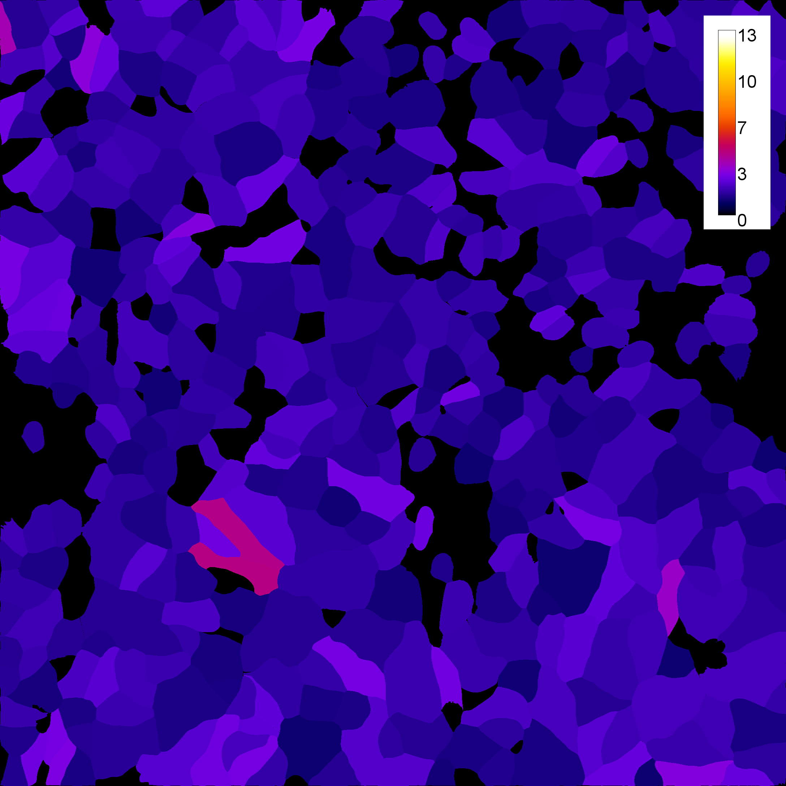
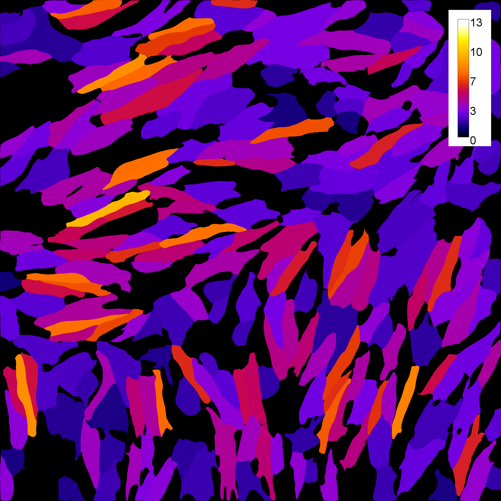
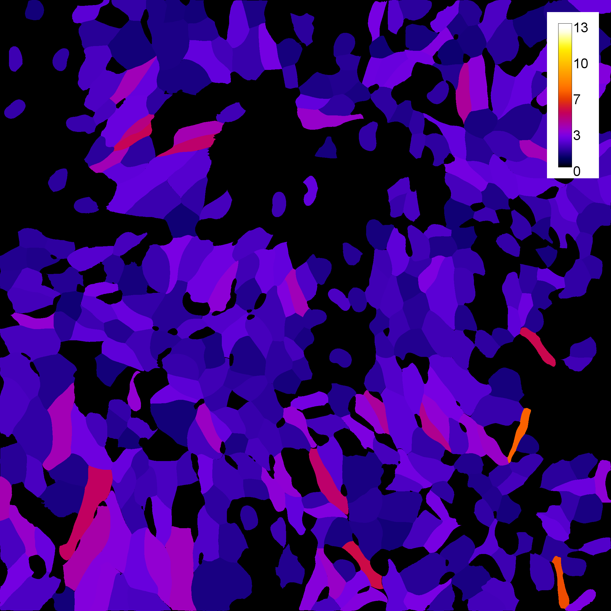
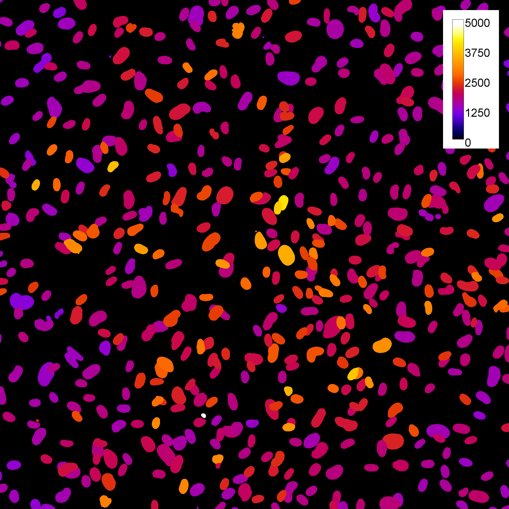
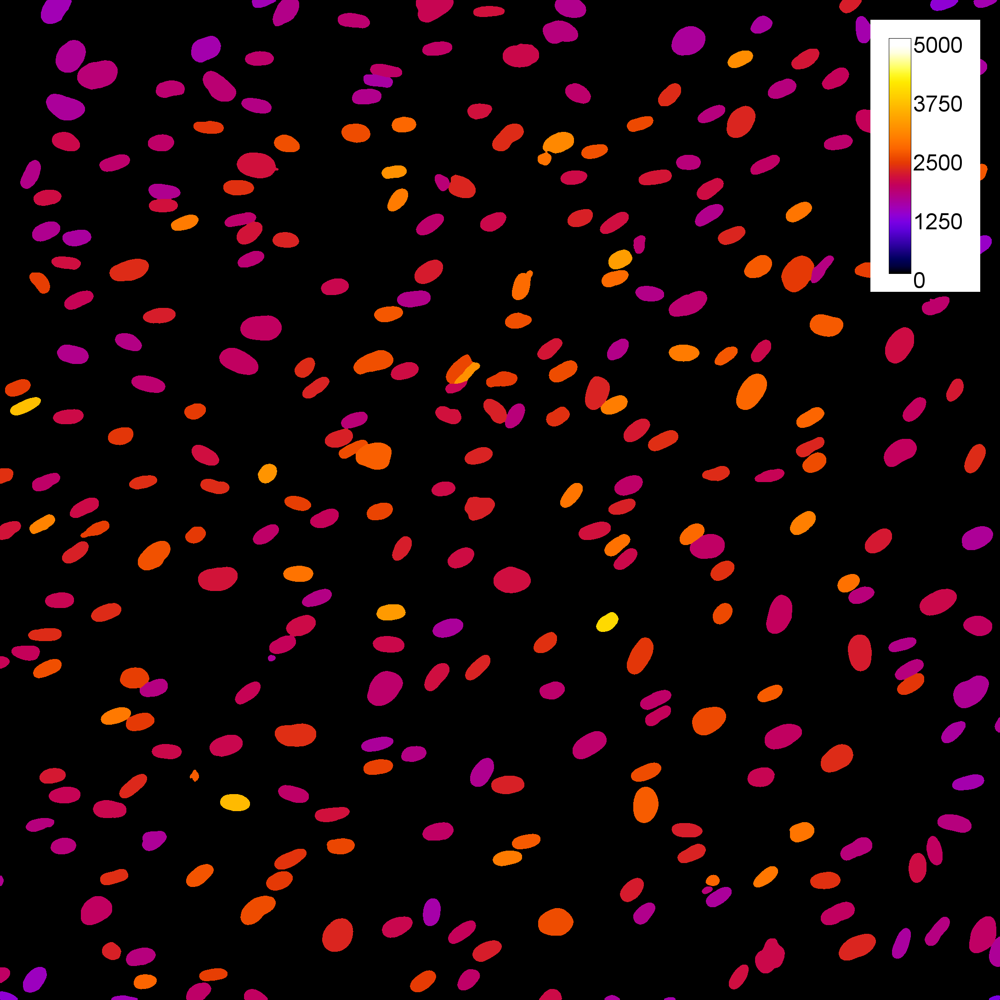
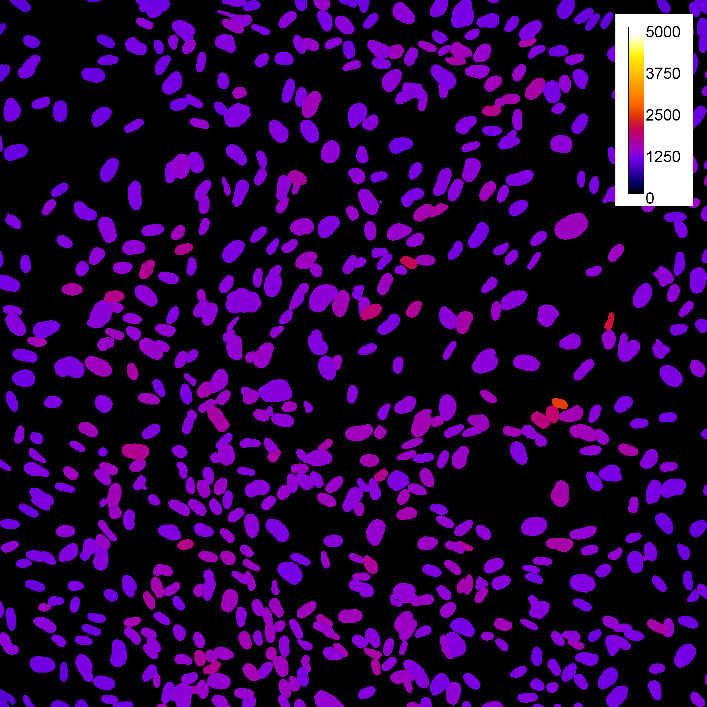

# Endothelial cell elongation and nuclear Hes1 under Notch activation and inhibition

## Overview

Two Fiji (ImageJ) macros that quantify the response of cultured endothelial cells to Notch activation and inhibition over time:

- **Workflow 1 – cell shape.** Segments endothelial cells from VE-cadherin (CDH5) staining with Cellpose and measures the elongation (aspect ratio) of every cell.
- **Workflow 2 – nuclear Hes1.** Segments nuclei from DAPI with Cellpose, measures nuclear Hes1 intensity and corrects it for background, both globally and locally around each nucleus.

Each workflow also writes a combined per-cell table of all images in its Results folder, and two Python scripts (`analysis/`) reproduce the analysis reported in the paper.

These macros were used in:

**[Paper title]**
**[Authors]**
[DOI]

Software package: Fiji (ImageJ), Cellpose (via the BIOP wrapper), Python
Workflow language: ImageJ macro, Python

<table>
<tr>
<th></th><th>Control</th><th>Notch activation</th><th>Notch inhibition</th>
</tr>
<tr>
<th>Cell elongation (day 5)</th>
<td></td>
<td></td>
<td></td>
</tr>
<tr>
<th>Nuclear Hes1 (day 5)</th>
<td></td>
<td></td>
<td></td>
</tr>
</table>

Top row: Workflow 1, cells color-coded by elongation, with nuclei-only segments shown as background (`FN_AR_filtered_flat.tif`). Bottom row: Workflow 2, nuclei color-coded by background-corrected Hes1 intensity (`FN_HesIntensity_flat.tif`).

## Repository contents

| File | Purpose |
|---|---|
| `Workflow1_CDH5AF647.ijm` | Cell segmentation and elongation (shape) analysis |
| `Workflow2_Hes.ijm` | Nuclear segmentation and Hes1 intensity with background correction |
| `analysis/` | Python scripts for the image-level and per-cell analysis; [`analysis/README.md`](analysis/README.md) explains how to run them in Visual Studio Code and describes every output file |
| `SampleData/` | Example input and output images (see `SampleData/README.md`) |

## Workflow 1: cell segmentation and elongation

1. Open the image (a .lif series or a .tif file) and duplicate the membrane (CDH5, channel 3) and nuclear (channel 4) channels.
2. Build a two-channel composite with fixed display ranges, so that saved images are comparable. The membrane signal gets brighter over time, so its display maximum is tuned per time point (12h: 5,000; 48h: 8,000; day 5: 12,000). The time point is recognised from the image name, and the values are set by `timePointLabels` and `membraneMaxByTime` at the top of the macro. The nuclear range is the same for all images. Display ranges affect only the saved images, not segmentation or measurements.
3. Segment cells (Segment mode):
   - Run Cellpose 4.2 on both channels with the model chosen in the dialog (cpsam, cpsam_v2, cpdino or a custom model; diameter 40 px).
   - Convert the label image to ROIs and save them (`FN_RoiSet.zip`).
4. Measure the shape of every cell with MorphoLibJ *Analyze Regions* on the label image. The analysis uses the elongation: the aspect ratio of the equivalent ellipse (`Ellipse.Elong`, 1 = round). It is measured on the label image rather than on ROI polygons because polygon-based ellipse fits were unreliable for irregular Cellpose shapes.
5. Save a cell image color-coded by elongation, and append one row per image to the run summary.
6. Optionally flag nuclei-only segments: Cellpose sometimes segments only the nucleus of a cell. Segments with an area at or below `nucleiOnlyMaxArea` (default 434 µm² = 1.2 × 362 µm², the 95th percentile of nuclear area from Workflow 2; the factor `nucleiOnlyFactor` also catches a nucleus with a little cytoplasm) are drawn in cyan in `FN_Overlay_marked.tif`, and left out of `FN_Overlay_filtered.tif`, `FN_Cells_filtered.csv` and `FN_AR_filtered.tif`. `FN_Cells.csv` and `FN_Overlay.tif` always keep all segments. The summary gains `N_NucleiOnly` and `N_Cells_Kept`. Both outputs are on by default and can be switched off (`saveMarkedOverlay`, `saveFilteredOutputs`).

To compare segmentation models, run Workflow 1 once per model. By default each model writes to its own `Results_<model>` folder.

## Workflow 2: nuclear Hes1 with background correction

1. Open the image (a .lif series or a .tif file) and duplicate the Hes1 (channel 3) and DAPI (channel 5) channels.
2. Build a two-channel composite with fixed display ranges.
3. Segment nuclei (Segment mode): run the Cellpose 3.1 nuclei model (`nuc`, diameter 40 px) on DAPI, convert to ROIs and save them.
4. Measure Hes1 in every nucleus: area, mean, SD, min/max, integrated density and median.
5. Estimate the Hes1 background in two ways:
   - **Global** (one value per image): median of all pixels outside the nuclei, after dilating every nucleus by `bgGapPx` = 3 px.
   - **Ring** (one value per nucleus): median of a band from 3 to 8 px outside the nucleus (`bgRingWidthPx` = 5), with all dilated nuclei excluded so neighbouring nuclei never count as background. Rings with fewer than `bgRingMinPixels` = 10 usable pixels are reported as NaN.
   - The median is subtracted (robust to debris and missed nuclei), and the mean is recorded alongside. Negative corrected values are kept on purpose.
6. Save QC images, including `FN_BgQC.tif`, which shows exactly which pixels were used for each background estimate, and append one row per image to the run summary.

## Output

For each image (with name FN), the macros save into a results subfolder next to the input file(s) (`Results_<model>` for Workflow 1, `Results_Hes` for Workflow 2):

| File | Workflow | Content |
|---|---|---|
| `FN_Cells.csv` | both | One row per cell or nucleus with all measurements |
| `FN_RoiSet.zip` | both | Segmented ROIs (Segment mode) |
| `FN_Composite.tif`, `FN_Composite_flat.tif` | both | Two-channel composite with fixed display ranges |
| `FN_Overlay.tif` | both | Composite with the segmentation outlines |
| `FN_AR.tif`, `FN_AR_flat.tif` | 1 | Cells color-coded by elongation (Fire LUT, calibration bar) |
| `FN_Overlay_marked.tif` | 1 | Overlay with kept cells in yellow and nuclei-only segments (area ≤ `nucleiOnlyMaxArea`) in cyan (`saveMarkedOverlay`) |
| `FN_Overlay_filtered.tif`, `FN_Cells_filtered.csv` | 1 | Overlay and per-cell table without the nuclei-only segments (`saveFilteredOutputs`) |
| `FN_AR_filtered.tif`, `FN_AR_filtered_flat.tif` | 1 | Elongation color-coded image with the nuclei-only segments shown as background (`saveFilteredOutputs`) |
| `FN_HesOnlyOverlay.tif` | 2 | Hes1 channel alone with the nuclear outlines |
| `FN_HesIntensity.tif`, `FN_HesIntensity_flat.tif` | 2 | Nuclei color-coded by Hes1 intensity |
| `FN_BgQC.tif` | 2 | Background QC: shaded = excluded nuclei + gap; yellow = ring pixels; unshaded = global background |

Per run, the macros also save `Summary_Cells.csv` (one row per image with mean/min/max of the main columns; Workflow 2 adds the per-image background values) and `<macro>_Parameters.txt` with every parameter used.

At the end of every run, each macro also writes a combined per-cell table of **all** `_Cells.csv` files in its Results folder: `All_Cells_Shape.csv` / `All_Cells_Shape_slim.csv` (Workflow 1) or `All_Cells_Hes.csv` / `All_Cells_Hes_slim.csv` (Workflow 2). Every row gets the image name (`SourceFile`) and the Results folder name (`ResultsFolder`). The slim files are the input for the Python analysis (see [`analysis/README.md`](analysis/README.md); switch off with `saveCombinedTables`).

Workflow 2 adds these per-nucleus columns: `BgGlobal_Median`, `BgGlobal_Mean`, `Mean_minus_BgGlobal`, `RawIntDen_minus_BgGlobal`, `BgRing_Median`, `BgRing_Mean`, `BgRing_NPixels`, `Mean_minus_BgRing` and `RawIntDen_minus_BgRing`.

## Dependencies

- Fiji: https://imagej.net/software/fiji/
- BIOP update site: Cellpose wrapper and *Label image to ROIs* (https://github.com/BIOP/ijl-utilities-wrappers)
- IJPB-plugins update site: MorphoLibJ (https://imagej.net/plugins/morpholibj)
- Bio-Formats (bundled with Fiji) to read .lif files; .tif files open directly
- A local Cellpose installation in a conda environment (https://github.com/MouseLand/cellpose):
  - Workflow 1: Cellpose 4.2 with the model(s) you want to use (cpsam, cpsam_v2, cpdino or custom)
  - Workflow 2: Cellpose 3.1 with the `nuc` model
- Python ≥ 3.9 for `analysis/` (packages in `analysis/requirements.txt`)

To install the Fiji plugins:

- Help › Update…
- Click *Manage update sites*
- Check *PTBIOP* and *IJPB-plugins*
- Click *Close*, then *Apply changes*, and restart Fiji

Test Cellpose once from Plugins › BIOP › Cellpose before running the macros.

## Usage instructions

Drag and drop the macro into Fiji and click *Run*. A dialog asks for:

- **Run mode:** *Segment* (run Cellpose) or *Update* (reuse saved ROIs, see below)
- **Image selection:** *Single open image*, *Single file (.lif or .tif)*, or *Whole folder* (pick any matching file in the folder; every file with one of the given **File extension(s)** whose name contains `CDH5AF647` (Workflow 1) or `Hes` (Workflow 2) is processed)
- **File extension(s):** the file type(s) to process, comma-separated, e.g. `.lif` (default), `.tif` or `.tif, .tiff`; used by *Single file* and *Whole folder*
- **Image file:** the file to analyse, or any file inside the folder to analyse
- **Cellpose conda env folder** and **model_path folder** (Segment mode only)
- Workflow 1 only: the **Cellpose model** (or a custom model name) and the **Results subfolder name** (blank = `Results_<model>`)

Click OK to run. Progress and warnings are written to the Log window.

A .lif file is processed series by series; a .tif file is one image, and its file name (without extension) is used as the image name in all outputs. TIFs saved from a .lif series in Fiji are named like `<name>.lif - Image 2.tif`; these get the same image name as when the .lif itself is processed (`<name>_Image_2`). TIFs should keep the original channel order and calibration, which is the case when a .lif series is saved from Fiji with File › Save As › Tiff. Don't keep .lif files and TIFs exported from them in the same folder, or the same images are processed twice.

Channel numbers, display ranges, Cellpose diameter, background-ring sizes and color-coding ranges are set in the *USER-EDITABLE PARAMETERS* section at the top of each macro.

## Manual correction

Most cells and nuclei are segmented correctly, but errors can be fixed manually and re-measured in *Update* mode, which skips Cellpose and reads the ROIs from file: `FN_RoiSet_manual.zip` if it exists, otherwise `FN_RoiSet.zip`.

1. Open the original image (FN), make sure no ROI Manager is open, and drag `FN_RoiSet.zip` into Fiji.
2. In the ROI Manager, select *Show All*; it is usually easier with *Labels* off.
3. **Delete** a false object: select its ROI and click *Delete*.
4. **Fix** an object: select its ROI, edit it (e.g. with the brush tool; Shift adds, Alt subtracts) and click *Update*.
5. **Add** a missed object: draw it (or use the Wand tool) and press `t` or click *Add*.
6. **Save:** click *Deselect*, then *More › Save…*, and save as `FN_RoiSet_manual.zip` in the same results folder. The exact file name matters.
7. Run the macro again in *Update* mode, with the same results subfolder name.

## Notes

- All images are assumed to have the same pixel size; the Cellpose diameter (40 px) and the background ring sizes are in pixels.
- Intensities are in arbitrary units and are comparable only between images acquired with identical settings.
- The Cellpose `diameter` parameter must not be 0 (it causes a division-by-zero error in Cellpose).
- Highly elongated cells are the hardest to segment consistently; in our data, different Cellpose models agreed well on round cells but less on long ones. `analysis/elongation_analysis.py` can compare models.

## Development

The macros and analysis scripts were developed with the assistance of Claude (Anthropic), an AI assistant, under the supervision of [your name]. The authors specified the analyses, tested the code on the study data, and verified all results.
